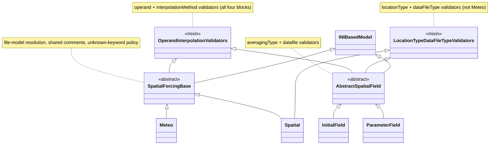

# External forcings file
The external forcing .ext file contains the forcing data for a [D-Flow FM](../../glossary.md#d-flow-fm) model.
This includes open boundaries, lateral discharges, source/sink terms, bubble screens, and meteorological forcings.
The documentation below only concerns the 'new' format (`ExtForceFileNew` in the MDU file).

## Source/sink quantity normalization

When reading `[SourceSink]` blocks, HYDROLIB-core removes the legacy `Delta`
suffix from quantity keys, case-insensitively:

| Input key | Normalized key |
|-----------|----------------|
| `salinityDelta` | `salinity` |
| `temperatureDelta` | `temperature` |
| `tracer<name>Delta` | `tracer<name>` |
| `sedFrac<name>Delta` | `sedfrac<name>` |

EXT keys are stored in lowercase, so `tracerOXYDelta`, for example, becomes
`traceroxy`. Normalization happens on read, not only during conversion, and
applies both when loading an `ExtModel` directly and when loading an `FMModel`
that references the file through `ExtForceFileNew`. Saving writes the normalized
keys without the suffix.

With `recurse=True`, referenced `.bc` files are also loaded and their quantity
names have any trailing `Delta` suffix removed, case-insensitively. A recursive
save writes these normalized quantities back to the `.bc` files. No
Delta-suffix warning is issued.

With `recurse=False`, EXT keys are still normalized, but referenced `.bc` files
are not loaded or rewritten. A `UserWarning` is issued when legacy keys are
normalized, advising you to remove the suffixes from the `.bc` quantities
manually or reload with `recurse=True` and save recursively. Reading alone does
not modify files on disk.

## Class hierarchy

The `[Meteo]` and `[Spatial]` blocks (this file) and the `[Initial]` / `[Parameter]` blocks
(the [initial field file](inifield.md)) are spatial-field blocks that share their field
validation. The shared logic lives in two plain validator mixins, while `INIBasedModel`
is mixed in only at the two concrete block bases.

Reading the diagram:

- `OperandInterpolationValidators` and `LocationTypeDataFileTypeValidators` are **independent plain
  mixins** (not models, and neither inherits the other). The former holds the `operand` /
  `interpolationMethod` validators shared by all four blocks; the latter holds the `locationType` /
  `dataFileType` validators shared by `Spatial`, `InitialField` and `ParameterField` (not `Meteo`,
  which has neither field).
- `INIBasedModel` is inherited only by the two concrete block bases: `SpatialForcingBase`
  (`Meteo` / `Spatial`) and `AbstractSpatialField` (`InitialField` / `ParameterField`).
- Each block base inherits exactly the validator mixins it needs: `SpatialForcingBase` inherits
  `OperandInterpolationValidators`; `AbstractSpatialField` inherits both mixins; and `Spatial` adds
  `LocationTypeDataFileTypeValidators` on top of `SpatialForcingBase`.
- `averagingType` is validated per-class (`Spatial`, `AbstractSpatialField`) rather than in a shared
  mixin, because `Meteo` reaches `OperandInterpolationValidators` too and stores `averagingType` as a
  raw integer.

## Model
::: hydrolib.core.dflowfm.ext.models
